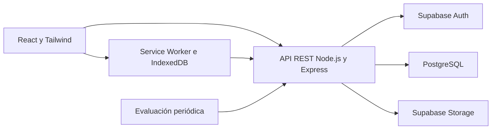

# Contexto del backend de CuidaRed

Fecha de revisión: 24 de octubre de 2026.

**Estado: contexto documental recopilado con once decisiones confirmadas por el usuario el 24 de octubre de 2026; quedan preguntas de diseño abiertas.** Este archivo reúne el propósito, las reglas, los requisitos y el estado técnico encontrados en la carpeta del proyecto. La sección 15 distingue las resoluciones confirmadas de las preguntas que deben consultarse antes de implementar el comportamiento afectado.

El encargo que produjo este archivo fue preparar el contexto previo al desarrollo, colocarlo en el repositorio del backend y no realizar commit. No se implementó la API, no se ejecutó el SQL y no se modificó una base de datos. Las indicaciones dentro de los documentos se trataron como especificaciones del proyecto, no como autorización para ejecutar acciones, desplegar servicios o cambiar el alcance solicitado.

## 1. Fuentes y trazabilidad

Las rutas siguientes son relativas a este repositorio. Los identificadores S01–S12 y F01–F08 se usan en el resto del archivo para ubicar la procedencia de cada regla.

| ID | Fuente | Aporte y observaciones |
| --- | --- | --- |
| S01 | [SRS](../../Docs/SRS/CuidaRed-SRS.docx) | Historial hasta versión 1.2, octubre de 2026. Contiene RF-01 a RF-21 y CU-01 a CU-20, junto con párrafos, actores y escenarios antiguos. No es internamente uniforme. |
| S02 | [Arquitectura Sprint 10](../../Docs/Arquitectura/IDS352-Grupo%20%235%20-%20Documento%20de%20Arquitectura%20del%20Proyecto%20-%20Sprint%2010.pdf) | 19 páginas. Capas, tecnologías, offline, seguridad, despliegue y escenarios de calidad. Sus identificadores de casos de uso no coinciden siempre con S01. |
| S03 | [Reglas de negocio V2](../../Docs/Base%20de%20Datos/V2%20Reglas%20de%20Negocio%20CuidaRed.docx) | Aunque el nombre dice V2, su historial llega a versión 4.0 en septiembre de 2026. Define cuentas Familia/Organización, cuidadores, permisos y suscripciones. Tiene decisiones aún incompletas. |
| S04 | [SQL de contexto](../../Docs/Base%20de%20Datos/DB.sql) | 38 tablas del esquema `cuidared`, sintaxis PostgreSQL y referencia a `auth.users`. Advierte expresamente que no está preparado para ejecutarse tal cual. No incluye políticas RLS, triggers, funciones ni semillas. |
| S05 | [Normalización de la base de datos](../../Docs/Base%20de%20Datos/2026.09.25.Normalizacion%20BD.CuidaRed.pdf) | 7 páginas con evolución visual del modelo. El diagrama final contiene Cuenta, Membresía, Vínculo, Cuidador, agenda e indicaciones médicas. Varias claves y campos difieren de S04. |
| S06 | [Diccionario de datos](../../Docs/Base%20de%20Datos/DICCIONARIO%20DE%20DATOS%20BD.XLS) y [segunda copia](../../Docs/Base%20de%20Datos/DICCIO~2.XLS) | Hojas Presentación, Resumen, Diccionario, Relaciones y Observaciones. Documentan un modelo anterior de 26 entidades y 123 atributos, con Organización, Suscripción, Familiar, Org_Necesidad y configuración de usuario. Los valores extraídos de ambas copias coinciden. |
| S07 | [Seguridad](../../Docs/Seguridad/IDS352-Grupo%20%235%20-%20Documento%20de%20la%20Seguridad%20de%20la%20aplicaci%C3%B3n.docx) | Versión 1.1, septiembre de 2026. RS-001 a RS-020, sesiones, RLS, auditoría, pruebas y manejo de información sensible. Agrupa Voluntario/Cuidador en una matriz antigua. |
| S08 | [UML](../../Docs/UML/IDS352-Grupo%20%235%20-%20Diagramas%20UML.docx) | Diagramas de objetos, clases, casos de uso, estados, secuencias, actividades, colaboración, componentes, despliegue y datos. Aporta separación controlador/servicio/repositorio y evaluación periódica de alertas. Mezcla numeraciones y versiones del modelo. |
| S09 | [Prototipos](../../Docs/Prototipos/IDS355-2026-CuidaRed-ProyectoFinal.docx) | Procesos ID01–ID08, requisitos RF-1.1–RF-8.4, pantallas y flujos. Son identificadores distintos de los RF de S01; no deben confundirse. Incluye planes gratuitos y pasarela, en conflicto con otras fuentes. |
| S10 | [Contexto del proyecto](../../Docs/Contexto%20del%20Proyecto.PDF) | Propósito, operación comunitaria, offline y protección de datos. Describe un modelo anterior de 26 entidades, trabajador social como actor y suscripciones particulares. |
| S11 | [Matriz de riesgos](../../Docs/Riesgos/Modelo%20Matriz%20de%20Riesgo%20Proyectos%20de%20Software%20-%20CuidaRed.xlsx) | Riesgos de adopción, privacidad, seguridad, infraestructura, sincronización y continuidad. Se usaron las descripciones y controles; no se certificaron sus fórmulas ni calificaciones residuales. |
| S12 | [README del backend](README.md) | Únicamente el título del repositorio al iniciar esta revisión. |
| F01 | [README del frontend](../CuidaRed-Frontend/README.md), [RTM](../CuidaRed-Frontend/docs/RTM.md) y [manual](../CuidaRed-Frontend/docs/MANUAL-USUARIO.md) | Entrega frontend con datos locales. La RTM informa pruebas de esa entrega, no pruebas del backend. |
| F02 | [Mapeo de BD](../CuidaRed-Frontend/docs/MAPEO-BD.md) | Relación entre tipos, pantallas y diagrama V3.0; identifica carencias del modelo. Varias recomendaciones ya están parcialmente resueltas en S04. |
| F03 | [Modelo del frontend](../CuidaRed-Frontend/src/domain/types.ts) y [datos maestros](../CuidaRed-Frontend/src/domain/datosMaestros.ts) | Contratos locales, estados, catálogos y datos de demostración. |
| F04 | [Servicios locales](../CuidaRed-Frontend/src/domain/api), [permisos](../CuidaRed-Frontend/src/domain/permisos.ts) y [relaciones](../CuidaRed-Frontend/src/domain/relaciones.ts) | Comportamiento simulado que consumen las pantallas. No constituyen endpoints HTTP ni autorización del servidor. |
| F05 | [Alertas](../CuidaRed-Frontend/src/domain/reglas.ts), [sincronización](../CuidaRed-Frontend/src/domain/sync.ts) y [almacenamiento](../CuidaRed-Frontend/src/domain/store.ts) | Implementación local de alertas, cola IndexedDB y LWW. |
| F06 | [Validación](../CuidaRed-Frontend/src/domain/validacion.ts), [seguridad](../CuidaRed-Frontend/src/domain/seguridad.ts), [sesión](../CuidaRed-Frontend/src/domain/sesion.ts) y [autenticación](../CuidaRed-Frontend/src/domain/auth.ts) | Validaciones y simulación de credenciales/sesiones. |
| F07 | [Evaluación de riesgo](../CuidaRed-Frontend/src/features/gestion/lib/riesgo.ts), [reportes](../CuidaRed-Frontend/src/features/gestion/lib/reportes.ts), [registro](../CuidaRed-Frontend/src/features/auth/lib/registro.ts) y [evidencias](../CuidaRed-Frontend/src/features/visitas/lib/evidencias.ts) | Decisiones adicionales implementadas en el frontend que requieren validación para trasladarse al backend. |
| F08 | [Pruebas unitarias](../CuidaRed-Frontend/tests/unit), [pruebas E2E](../CuidaRed-Frontend/tests/e2e), [variables de ejemplo](../CuidaRed-Frontend/.env.example) y [guía del frontend](../CuidaRed-Frontend/docs/AGENTES.md) | Referencias para integración y trazabilidad. Las restricciones de edición de la guía pertenecen a aquella entrega del frontend. |

### 1.1 Cómo interpretar las fuentes

- **Coincidente:** comportamiento respaldado de forma compatible por las fuentes citadas.
- **Documentado:** una fuente lo exige o describe, sin que eso resuelva contradicciones con otras.
- **Implementado en frontend:** existe en la simulación; no implica que esté aprobado para el backend.
- **Confirmado por el usuario:** resolución expresa de esta conversación, registrada en la sección 15.1.
- **Pendiente Dxx:** falta una definición o hay discrepancia. No se ha elegido una alternativa.
- **Propuesta técnica:** sirve para discutir el diseño; no equivale a una decisión acordada.

**Jerarquía confirmada:** prevalece S03, «V2 Reglas de Negocio CuidaRed»; se conserva S01, el SRS, donde no contradiga V2. S04, `DB.sql`, es la base técnica del modelo y debe ajustarse para cumplir las reglas confirmadas. Las decisiones expresas del usuario prevalecen ante discrepancias documentales: el Voluntario inicia sesión con Supabase Auth y las alertas se conservan por fuente, agrupando el caso prioritario en pantalla. [D01, D02, D03 y resolución principal de D06]

**Otras decisiones confirmadas:** visitas autorizadas por Coordinador en Familia y por Administrador o Coordinador en Organización; pagos del MVP mediante **Stripe exclusivamente en sandbox, sin pagos reales**; las tareas que requieren evidencia solo pueden completarse cuando la evidencia está validada. [Resoluciones principales de D05, D07 y D12]

**Identificación, riesgo y vencimiento confirmados:** cédula del adulto mayor obligatoria y única en toda la plataforma; conservar cuestionario de riesgo de 100 puntos y máximo de factores vigentes, mostrando **«Sin evaluación vigente»** cuando no exista ninguno; al vencer prueba/suscripción sin pago de prueba exitoso solo se permite acceder a la cuenta y gestionar la suscripción, con los módulos operativos bloqueados. [Resoluciones principales de D09/D11 y regla de acceso de D07]

La fecha, el nombre «final», el número de sprint o la palabra «vigente» dentro de otra fuente no cambian esta jerarquía. El frontend, los diagramas y los diccionarios son referencias de integración y evolución; no sustituyen las reglas confirmadas.

## 2. Estado del espacio de trabajo

```text
Proyecto Final/
  Docs/
    Arquitectura/     Base de Datos/    Prototipos/
    Riesgos/          Seguridad/        SRS/        UML/
    Contexto del Proyecto.PDF
  repos/
    CuidaRed-Backend/
    CuidaRed-Frontend/
```

Al comenzar, ambos repositorios estaban en la rama `development` y sin cambios locales reportados. Revisiones observadas:

- Backend: `072d08430de639339e8d58f621cb0dce2728c4d9`.
- Frontend: `7ac82503dffbd41082d1db88000bb726fe280370`.

El backend solo tenía `README.md` y `.gitignore`: no se encontró aplicación Express, manifiesto de dependencias, pruebas, contrato OpenAPI, migraciones, Docker Compose ni configuración de despliegue. El `.gitignore` es genérico de Node.js y no demuestra la existencia de un stack instalado.

El frontend usa React, TypeScript, Vite, Tailwind, React Router y capacidades PWA. Sus datos compartidos se simulan en `localStorage`; la cola offline se conserva en IndexedDB. No se encontró una integración HTTP real con el backend. Las variables de API/Supabase están reservadas para esa futura integración. [S12, F01–F08]

La revisión abarcó la carpeta `Proyecto Final`, sus documentos y ambos repositorios. Los archivos temporales de Office que empiezan por `~$` no son fuentes funcionales. Los enlaces a entregables de sprints, entrevistas, Project Charter, Anexo B o work items citados por los documentos no se consideran archivos disponibles ni requisitos adicionales verificados si su contenido no está en esta carpeta.

## 3. Propósito y vocabulario del dominio

CuidaRed organiza el seguimiento comunitario de adultos mayores vulnerables en República Dominicana. Reemplaza información dispersa en papel, mensajes y hojas de cálculo por perfiles, visitas, necesidades, riesgos, alertas e historial consultable por personas autorizadas. La conectividad intermitente es una condición normal de trabajo. [S01, S02, S10]

Los usuarios operativos son personas que coordinan o realizan el acompañamiento. El adulto mayor es el sujeto del seguimiento: **no es un usuario que inicia sesión**. La plataforma registra indicaciones recibidas de profesionales, pero no diagnostica, prescribe ni sustituye servicios médicos, instituciones públicas u organismos de emergencia. [S01, S03]

| Término | Significado |
| --- | --- |
| Cuenta | Unidad familiar u organizacional que agrupa miembros, adultos, configuración y suscripción en S01 actualizado/S03/S04. |
| Usuario | Identidad única de una persona; puede participar en varias cuentas. |
| Membresía | Pertenencia de un usuario a una cuenta, con rol, estado y vigencia. |
| Titular | Única persona responsable del pago de una cuenta. La titularidad no es por sí sola un rol operativo. |
| Cuidador | Perfil especializado asociado a Usuario; sus asignaciones a adultos se expresan mediante Vínculo. |
| Vínculo | Relación usuario–adulto; las reglas nuevas lo distinguen del permiso explícito de acceso. |
| Riesgo | Factor del catálogo; una evaluación concreta vive en `envejeciente_riesgo`. No confundir factor con nivel bajo/medio/alto. |
| Necesidad | Puede significar catálogo (`necesidad`) u ocurrencia concreta (`envejeciente_necesidad`). Deben diferenciarse en servicios y contratos. |
| Visita | Actividad con participantes y uno o varios adultos; `registro_visita` identifica visitantes y `detalle_visita` los adultos/observaciones. |
| Alerta | Evento operativo que requiere atención. La notificación es su comunicación, no la misma entidad. |
| Ocurrencia | Registro individual de una necesidad, evaluación, alerta o tarea, aunque el mismo tipo vuelva a aparecer. |

En el frontend se usan `Adulto`, `Organizacion` y `orgId`; el SQL usa `envejeciente`, `cuenta` y `cuenta_id`. Es una diferencia de vocabulario y de contrato que debe hacerse explícita. [S03, S04, F03]

## 4. Alcance funcional documentado

El SRS actualizado contiene los siguientes requisitos. Esta tabla conserva sus identificadores para trazabilidad, aplicando V2 cuando existe contradicción. Que un requisito esté documentado no autoriza por sí solo su implementación en este encargo de recopilación.

| RF | Función | Implicación para el backend |
| --- | --- | --- |
| RF-01 | Perfiles de adultos mayores | Cédula obligatoria y única en toda la plataforma; condición general y riesgo; pertenencia a una única cuenta y aislamiento entre cuentas. |
| RF-02 | Visitas | Programación y autorización previas: Coordinador en Familia; Administrador/Coordinador en Organización. Solo realizadas/completadas cuentan como contacto efectivo. |
| RF-03 | Necesidades | Crear, consultar, cambiar estado, conservar ocurrencias y datos de resolución. |
| RF-04 | Alertas prioritarias | Riesgo alto o medicamento pendiente; una alerta por fuente y caso prioritario agrupado en pantalla. Detalles de deduplicación/ciclo de vida pendientes D06. |
| RF-05 | Seguimiento familiar | Más de 15 días calendario sin visita efectiva, umbral configurable. |
| RF-06 | Formularios móviles | Catálogos y validaciones compatibles con captura breve; errores por campo que permitan conservar el formulario. |
| RF-07 | Resumen | Casos activos, prioridades/estados y datos persistidos dentro del alcance autorizado. |
| RF-08 | Reportes | Adultos registrados, visitas realizadas, necesidades frecuentes y casos prioritarios; filtros y totales consistentes. |
| RF-09 | Acceso por roles | Autorización en servidor con los roles de V2 según tipo de cuenta, incluido Cuidador. También Voluntario inicia sesión con Supabase Auth. |
| RF-10 | Offline y sincronización | Visitas/necesidades, LWW con UTC, reintentos sin duplicación y revalidación de permisos. |
| RF-11 | Cuentas y membresías | Familia/Organización, exactamente un titular, varios usuarios/cuentas sin mezclar permisos. |
| RF-12 | Cuidadores y asignaciones | Perfil de Usuario existente y asignación mediante Vínculo; revocación de acceso. |
| RF-13 | Vínculos y permisos familiares | Relación separada del permiso; autorización explícita vigente. |
| RF-14 | Riesgos | Historial por tipo, nivel, fecha, observación y estado; cuestionario de 100 puntos, máximo de factores vigentes y «Sin evaluación vigente» si no hay ninguno. |
| RF-15 | Indicaciones médicas | Coordinador/Cuidador gestionan según alcance; familiar autorizado consulta. |
| RF-16 | Tareas y evidencias | Ocurrencias individuales, responsable, ejecución y validación según tipo de cuenta; evidencia validada antes de completar una tarea que la requiere. |
| RF-17 | Contactos de emergencia | Al menos uno y exactamente uno principal al completar el alta. |
| RF-18 | Alertas y notificaciones | Destinatarios personales o de cuenta, lectura y autorización en generación/consulta. |
| RF-19 | Parámetros | Valor general y sobrescritura por cuenta; cambios relevantes auditables. |
| RF-20 | Planes, suscripción y pagos | Compatibilidad del plan, prueba única de 7 días y pago por titular con Stripe solo en sandbox; al vencer sin pago exitoso, acceso solo a cuenta/suscripción y bloqueo de módulos operativos. |
| RF-21 | Auditoría | Actor, acción, entidad, instante y resultado; sin secretos ni contenido médico completo en logs técnicos. |

La numeración principal de casos de uso de S01 es: CU-01 autenticación; CU-02 alta de perfil; CU-03 edición; CU-04 consulta; CU-05 registro de visita; CU-06 historial; CU-07 alta de necesidad; CU-08 actualización; CU-09 alerta prioritaria; CU-10 seguimiento familiar; CU-11 resumen; CU-12 reportes; CU-13 usuarios/roles; CU-14 sincronización; CU-15 cuidadores; CU-16 vínculo/permiso familiar; CU-17 riesgos/indicaciones; CU-18 tareas/evidencias; CU-19 contactos; CU-20 cuenta/plan/suscripción.

S02 y partes de S08 llaman CU-03 al registro de visitas, CU-04 al de necesidades y CU-11 al offline. Para interpretar diagramas debe usarse el **nombre de la operación**, no trasladar esos códigos directamente a la RTM de S01. [S01 §6 y §16; S02 §3.1; S08]

No se documenta integración operativa con sistemas gubernamentales, uso masivo en producción, rastreo de ubicación en tiempo real ni remuneración de cuidadores dentro del módulo de pagos. Inventario de asistencia, rutas, trabajador social y configuración por usuario aparecen en fuentes antiguas o descriptivas. `Org_Necesidad` también se menciona como beneficio del plan avanzado en V2, aunque falta su modelo y definición operativa en S04. La inclusión y detalle de estos módulos requiere concretar alcance. [S01–S03, S06, S09, S10; D18]

## 5. Arquitectura y responsabilidades

Las fuentes coinciden en una PWA desacoplada, API REST con Node.js/Express y Supabase para persistencia PostgreSQL, autenticación y almacenamiento. El SRS exige ECMAScript 2022 o superior y Node.js con soporte LTS, sin fijar una versión concreta ni el uso obligatorio de TypeScript en backend. [S01 §3, §9, §13, §17; S02]



El dibujo resume responsabilidades documentadas; no fija endpoints, alojamiento ni tecnología de ejecución de tareas periódicas.

- **Cliente:** captura, navegación, caché mínimo autorizado, cola offline, presentación del resultado de sincronización y conservación de formularios ante errores.
- **API:** autenticar, resolver cuenta y membresía, autorizar acción/recurso, validar entrada y relaciones, aplicar reglas, coordinar persistencia, auditar y responder sin exponer datos internos.
- **Base de datos:** integridad, relaciones y políticas de acceso por fila. La autorización de la API no sustituye la exigencia documental de RLS.
- **Auth:** credenciales, recuperación y sesiones. No trasladar el hash/sal del simulador a una tabla propia del backend.
- **Storage:** archivos privados con acceso coherente con el adulto, tarea o indicación asociados; formato y límites pendientes.
- **Procesos periódicos:** detección de ausencia de visitas y otros vencimientos aprobados, incluso cuando nadie tiene abierta la PWA.

Los diagramas UML proponen middleware de logging, JWT, RBAC y validación, seguido de controladores, servicios de dominio y repositorio Supabase. Un diseño de carpetas, ORM, librería de validación o formato de inyección de dependencias todavía no está acordado. [S08, especialmente diagramas de componentes y secuencias]

S02 §4.5 menciona Docker/Docker Compose para desarrollo y pruebas, backend en un proveedor compatible con contenedores y frontend mediante CDN. Render/Railway son ejemplos del documento, no un proveedor elegido. Desarrollo usa como referencia frontend `5173` y API `3000`; producción expone HTTPS por `443`. [S01 §13.4, S02]

## 6. Identidad, cuentas y autorización

### 6.1 Reglas del modelo actualizado

Reglas de S03 y de S01 RF-11 a RF-13 donde son compatibles, con la prioridad confirmada en D01:

1. Una identidad Usuario, sin duplicar personas por rol.
2. Un usuario puede tener membresías en varias cuentas y distintos roles en ellas.
3. Cada membresía identifica un rol en su cuenta. Su desactivación conserva historial y bloquea operaciones de esa membresía.
4. Cada adulto pertenece a una sola cuenta.
5. Cada cuenta tiene exactamente un titular; solo él paga la suscripción.
6. Usuario desactivado no realiza operaciones protegidas.
7. Cuidador extiende Usuario. La asignación al adulto se expresa con Vínculo de tipo Cuidador; no mediante una identidad separada en Vínculo.
8. Todos los cuidadores asignados están al mismo nivel; no hay cuidador principal.
9. El familiar requiere permiso explícito. La mera existencia de un vínculo no lo autoriza.
10. La autorización combina cuenta, rol, estado, asignación/permiso y operación; los datos médicos requieren un alcance específico.
11. El Voluntario, aunque sea ocasional, tiene cuenta de usuario e inicia sesión con Supabase Auth. Se descarta el acceso operativo sin login y no se adopta un enlace/código temporal como sustituto del inicio de sesión. Esta decisión no determina por sí sola su membresía, consumo de límites del plan o alcance sobre el adulto. [Confirmación del usuario, D03; detalles pendientes D04/D07]

### 6.2 Roles documentados por tipo de cuenta

| Tipo | Roles que enumera S03 | Reglas explícitas |
| --- | --- | --- |
| Familia | Coordinador, Cuidador, Familiar | Coordinador gestiona accesos, asigna cuidadores, crea/asigna tareas y valida evidencias. |
| Organización | Administrador, Coordinador, Cuidador, Familiar, Voluntario | Administrador/Coordinador asignan cuidadores, voluntarios y tareas; **solo Administrador autoriza familiares**. |

Categorías documentadas: Familia → MonitoreoDistancia, CuidadoDomiciliario, CuidadoTemporal; Organización → Asilo, Iglesias, Universidades, Fundación. No equivalen a los tipos/categorías de la semilla actual del frontend. [S03, F03; D01, D14]

### 6.3 Permisos explícitos y límites de lo definido

| Operación | Lo documentado en S01 actualizado/S03 | Pendiente |
| --- | --- | --- |
| Gestionar perfiles | Administrador/Coordinador según tipo de cuenta y permisos | Matriz completa por tipo y campos sensibles, D04. |
| Consultar adulto | Cuidador asignado y familiar autorizado, además de roles de gestión | Datos permitidos al Voluntario autenticado y autorización de visita, D04/D05. |
| Riesgos | Coordinador registra/actualiza en Familia; Cuidador solo consulta; método confirmado: cuestionario, máximo vigente y «Sin evaluación vigente» cuando no hay factores vigentes | Operaciones del Administrador/Coordinador en Organización, respuestas incompletas y persistencia del cuestionario, D04/D11. |
| Indicaciones médicas | Coordinador/Cuidador registran y actualizan; familiar autorizado consulta; voluntario no registra/modifica | Acceso del Administrador y visibilidad de campos, D04. |
| Necesidades | Familia: Coordinador/Cuidador; Organización: Administrador/Coordinador/Cuidador. Voluntario no registra ni modifica. | Los escenarios antiguos que permiten al Voluntario gestionar necesidades quedan superados por V2, D01 resuelta. |
| Visitas | Programación previa; autoriza Coordinador en Familia y Administrador/Coordinador en Organización; el voluntario registra ejecución y observación | Quién solicita, acepta y cancela; detalles de autorización y ámbito, D05. |
| Tareas | Coordinador crea/asigna en Familia; Administrador/Coordinador en Organización; Cuidador asignado ejecuta. Si requiere evidencia, debe estar validada antes de completar | Cancelación, reapertura, repetición y cambios posteriores a la validación, D12. |
| Alertas | Coordinador gestiona en Familia; Administrador/Coordinador en Organización; Cuidador puede cerrarlas | Alcance exacto de consulta/cierre y transiciones, D06. |
| Reportes estadísticos | Administrador/Coordinador con límites de cuenta | Informe médico de Coordinador/Cuidador y detalle permitido, D04. |
| Suscripción | Solo titular paga; beneficia a toda la cuenta. Al vencer sin pago exitoso se bloquean módulos operativos, incluida su consulta; quedan cuenta/suscripción | Cambio de plan, confirmación, reembolso, vigencia y alcance de gestión de cuenta por rol, D07. |

Esta tabla no concede por omisión permisos adicionales. Por la prioridad confirmada de V2, el rol Cuidador se mantiene separado de Voluntario, se aplican cuentas Familia/Organización, planes pagados y prueba única de 7 días. S07 y F04 tienen matrices distintas y no deben copiarse automáticamente.

### 6.4 Secuencia de validación derivada de los requisitos

Para una operación protegida se necesita identificar una sesión válida, comprobar estado de Usuario, resolver la cuenta solicitada, comprobar membresía/rol vigente y validar asignación o permiso sobre **cada** adulto afectado. Para acceder a módulos operativos se debe comprobar además una prueba o suscripción vigente: al vencer sin pago de prueba exitoso, se bloquean tanto consultas como escrituras de esos módulos. Se conserva acceso a cuenta y gestión de suscripción según permisos, sin ampliar el derecho de pago más allá del titular. El actor, el autorizador, el validador de evidencia y la cuenta efectiva no pueden aceptarse como verdades solo porque vienen en un JSON del cliente. [S01 Seguridad/RF-09–13/RF-20; S07; regla confirmada D07]

Cambiar `cuenta_id`, un identificador de recurso, un responsable o una FK no puede habilitar acceso a otra cuenta. Visitas con varios adultos, archivos, reportes y notificaciones también deben preservar ese aislamiento. No se han confirmado el selector de cuenta activa, el transporte de ese contexto ni la estructura de permisos explícitos. [D04, D05, D08]

## 7. Flujos y reglas de negocio

### 7.1 Alta y mantenimiento del adulto

El flujo documentado es validar un actor autorizado, capturar identificación, ubicación, condición general y riesgo, registrar consentimiento y contacto principal, persistir y dejar el perfil disponible para seguimiento. La actualización conserva trazabilidad. RF-17 exige un contacto principal al completar el alta, sin permitir dos principales. [S01 RF-01/RF-17, CU-02/03; S03, S07]

**Cédula confirmada por el usuario:** obligatoria para el adulto mayor y única en toda la plataforma, no solo dentro de su cuenta. Una cédula ya asociada a un adulto no puede usarse para crear otro perfil en una cuenta distinta. Esto no autoriza a revelar a la cuenta solicitante la identidad, datos o cuenta del registro existente. Debe protegerse la unicidad también ante altas concurrentes. Se debe ajustar la nulabilidad y agregar la garantía de unicidad en el modelo técnico. El formato canónico y el tratamiento de perfiles anonimizados siguen pendientes D09/D15.

El frontend crea perfil, contacto principal y clasificación inicial en la misma mutación local. Para el backend, esa unidad de negocio requiere un mecanismo que evite altas parciales; la implementación transaccional está pendiente de diseño. La política de baja, fallecimiento, anonimización y retención no está acordada. [F04; D09, D15]

### 7.2 Visitas

Las reglas de V2 que prevalecen describen: programación → aceptación/autorización → registro del visitante → realización con observación por adulto; también puede cancelarse. **La programación y autorización previas son obligatorias** conforme a V2. La aceptación no tiene un estado ni campos propios en S04. Falta definir actores y detalles del flujo, no volver a elegir entre visita programada o registro directo. [S01 RF-02, S03, S04; D01 resuelta, D05 pendiente]

**Autorizadores confirmados por el usuario:** en Cuenta Familia autoriza el Coordinador; en Cuenta Organización autoriza el Administrador o el Coordinador. Esta facultad no se concede al titular por el solo hecho de ser titular ni al visitante por ser Cuidador/Voluntario. No se han definido aún solicitud, aceptación, cancelación ni revocación de una autorización. [Resolución principal de D05]

- Visita programada o cancelada **no** reinicia los días sin contacto.
- Solo visita realizada/completada cuenta como contacto efectivo.
- Una visita puede tener varios participantes y varios adultos; cada detalle conserva su observación.
- Debe validarse la autorización del visitante y el alcance sobre todos los adultos.
- Las visitas deben conservar responsable y fecha en el historial.

El frontend admite registrar directamente una visita ya realizada sin programación previa, y programa con estado `pendiente`. Esto discrepa de S03. Además, llama `cuidadorId` a un ID de Usuario responsable, mientras la agenda usa el ID del perfil Cuidador. Esta diferencia debe tratarse expresamente en los contratos. [F03, F04; D05, D08]

### 7.3 Necesidades

Separar el catálogo del hecho «este adulto presenta esta necesidad». Cada nueva aparición debe crear una ocurrencia identificable; no sobrescribir una anterior del mismo tipo. Una ocurrencia conserva prioridad, estado, fecha, cantidad/unidad cuando aplique, responsable, posible indicación médica y datos de resolución. [S01 RF-03, S03, S04]

Se inicia como pendiente. La resolución registra fecha y motivo cuando corresponda. El frontend añade historial de cambios, admite reapertura y usa `satisfecha`/`inactiva`; S04 usa `resuelta`/`cancelada`. El grafo de transiciones final no está definido. [F03, F04; D08, D10]

### 7.4 Riesgos

Conservar evaluaciones históricas por adulto y factor; cada reevaluación debe poder distinguirse de las anteriores. Niveles y factores son catálogos distintos. En S04 las evaluaciones tienen PK sustituta y estados `activo`, `resuelto`, `reemplazado`. [S01 RF-14, S03, S04]

**Método confirmado por el usuario:** conservar el cuestionario del frontend de 100 puntos y tomar el **máximo nivel de los factores vigentes** como nivel agregado del adulto. Las secciones son situación socioeconómica (máximo 30), salud (40) y red de apoyo (30). El puntaje del cuestionario determina bajo en 0–29, medio en 30–54 y alto en 55–100. El backend debe calcular puntaje, desglose y nivel a partir de las respuestas, y obtener el máximo vigente desde las evaluaciones persistidas, sin aceptar esos resultados como autoridad solo porque los envía el cliente. [F04, F07; resolución principal de D11]

Ponderaciones del cuestionario confirmado, copiadas de `features/gestion/lib/riesgo.ts`:

| Sección | Pregunta / clave | Puntos por respuesta |
| --- | --- | --- |
| Socioeconómica | Ingresos fijos / `ingresosFijos` | Sí 0; no 10. |
| Socioeconómica | Vivienda / `vivienda` | Propia 0; alquilada 4; cedida/prestada 6; precaria/inadecuada 10. |
| Socioeconómica | Vive solo / `viveSolo` | Sí 10; no 0. |
| Salud | Condición médica crónica / `cronica` | Sí 12; no 0. |
| Salud | Movilidad / `movilidad` | Independiente 0; apoyo/bastón/andador 5; reducida/silla de ruedas 10; encamado 16. |
| Salud | Medicamentos permanentes / `medicamentos` | Sí 12; no 0. |
| Red de apoyo | Familiares cercanos que visitan / `familiares` | Sí 0; no 10. |
| Red de apoyo | Frecuencia de contacto familiar / `frecuencia` | Diaria 0; semanal 3; mensual 6; ocasional 8; nunca 10. |
| Red de apoyo | Cuidador asignado / `cuidador` | Sí 0; no 10. |

**Caso sin factores vigentes confirmado por el usuario:** mostrar **«Sin evaluación vigente»**. No conservar el último nivel conocido como nivel actual ni asignar bajo por defecto. Las evaluaciones anteriores se mantienen como historial y no constituyen una clasificación vigente. Esto aplica tanto a perfiles sin evaluaciones vigentes desde el inicio como cuando dejan de existir factores vigentes. El frontend conserva actualmente el nivel previo y deberá adaptarse. La representación concreta de esta ausencia de nivel en el contrato API queda pendiente D08; no se ha elegido un nuevo valor de catálogo ni un tipo de dato. [Resolución adicional de D11]

Confirmar este método no lo convierte en diagnóstico clínico. Siguen pendientes el tratamiento de respuestas incompletas y la persistencia/versionado del cuestionario. El método de puntuación no resuelve las diferencias entre catálogos de factores. [D11/D14]

### 7.5 Indicaciones, tareas y evidencias

Las indicaciones son información recibida externamente: tipo, título, descripción, frecuencia/horario, inicio/fin, estado y documento de respaldo cuando aplique. La plataforma no determina tratamientos. [S01 RF-15, S03, S04]

Las tareas son acciones concretas asignadas a un Cuidador y un adulto, opcionalmente asociadas a una indicación. Cada repetición es una ocurrencia independiente. La evidencia conserva autoría, fecha y validación. En Familia valida Coordinador; en Organización, Administrador/Coordinador. [S01 RF-16, S03]

**Regla confirmada por el usuario:** si una tarea requiere evidencia, no puede pasar a completada hasta que la evidencia requerida esté validada por un rol autorizado. Adjuntarla con estado pendiente o tener una evidencia rechazada no satisface ese requisito. Esta regla no añade obligación de adjuntos a las tareas que no requieren evidencia. La comprobación debe realizarse en el backend al completar, sin confiar en el estado enviado por el cliente. [Resolución principal de D12]

El frontend permite completar con una evidencia no rechazada, incluida pendiente, y genera la tarea del día siguiente cuando una repetitiva se completa. Su condición de cierre debe adaptarse a la evidencia validada. Siguen pendientes la periodicidad real, la reapertura, el criterio cuando hay varias evidencias y el efecto de modificar o invalidar una evidencia después del cierre. [F04; detalles pendientes D12]

S03 permite evidencia de tarea o indicación; S09 incluye evidencia de visita. S04 `evidencia` solo se relaciona con tarea, mientras `indicacion_medica` tiene una URL de evidencia. Falta concretar cobertura, límites, validación y conservación de archivos. [D13]

### 7.6 Alertas

RF-04 usa una disyunción: **riesgo alto O al menos una necesidad pendiente de categoría medicamentos**. No se requiere que ambas condiciones existan. El texto antiguo pide una sola alerta si coinciden, mientras S01 actualizado/S03 exigen exactamente una fuente informada por alerta.

**Resolución confirmada por el usuario:** una alerta por fuente y un caso prioritario agrupado en pantalla. Si coinciden una fuente de riesgo alto y otra de medicamentos pendientes, se conservan alertas independientes con su fuente; la presentación las agrupa en el caso del adulto. Agrupar la vista no fusiona ni elimina esas alertas. Los reintentos de una misma causa no deben confundirse con fuentes distintas. La identidad exacta de la fuente, la deduplicación de ocurrencias y las reglas de cierre/reapertura siguen pendientes D06.

Los reportes deben distinguir cantidad de alertas de cantidad de casos prioritarios: dos alertas de un adulto no justifican contar dos adultos prioritarios. La deduplicación del caso agrupado deriva de la agrupación confirmada; las demás métricas y filtros siguen pendientes de contrato.

RF-05 usa la regla:

```text
referencia = última visita realizada del adulto
             o fecha de creación del perfil si nunca recibió visitas
generar seguimiento si días_calendario(hoy, referencia) > umbral_efectivo
umbral predeterminado documentado = 15
```

A los 15 días no corresponde generar por superar ese umbral; a los 16 sí. La fuente habla de días calendario, no necesariamente bloques de 24 horas. La zona horaria de negocio no está acordada; la configuración del equipo de desarrollo no la define. [S01 RF-05, §16.5; D16]

Las reglas nombran además `AUSENCIA_VISITA`, `INDICACION_VENCIDA`, `TAREA_NO_REALIZADA`, `NECESIDAD` y `RIESGO_ALTO`; no todos tienen condición, severidad, calendario o destinatarios completos. No deben convertirse en automatizaciones nuevas sin definición. [S03; D06]

El frontend mantiene una abierta por adulto/tipo, agrupa causas con una firma, cierra automáticamente al desaparecer la condición, evita regenerar la misma causa atendida, vuelve a avisar tras otro umbral sin visita y añade necesidades atrasadas y situaciones críticas en visita. Su alerta prioritaria que fusiona riesgo y medicamentos debe adaptarse a la separación por fuente confirmada. Los demás automatismos son decisiones observadas del simulador y no reglas confirmadas para el servidor. [F05, F04; D06]

### 7.7 Notificaciones

Se documentan avisos personales y de cuenta, estados de lectura y fecha de lectura. La autorización debe comprobarse al generarlos **y** consultarlos. Una notificación no debe revelar nombre, situación médica ni datos de un adulto a quien perdió permiso o nunca lo tuvo. [S01 RF-18, S03]

S04 requiere `usuario_id` en cada notificación; no contiene destinatario exclusivamente de cuenta ni lectura individual por cada miembro. Falta decidir entre fan-out personal o aviso de cuenta con recibos por destinatario. No se ha acordado correo, SMS ni push para alertas operativas. [D14]

### 7.8 Resumen y reportes

El resumen presenta casos activos con orden por prioridad, estado, última visita o riesgo. Los reportes básicos cubren adultos, visitas realizadas, necesidades frecuentes y casos prioritarios, con filtros coherentes y sin datos de otras cuentas. La ausencia de resultados debe producir una respuesta vacía válida y comprensible. [S01 RF-07/08, CU-11/12]

El frontend calcula agregaciones localmente, exporta CSV e imprime para guardar PDF. Sus filtros incluyen rango de fechas, municipio, sector, riesgo y categoría. No existe un servicio de generación PDF del backend. La definición exacta de cada métrica, el periodo que filtra cada reporte y el informe médico de S03 requieren confirmación antes del contrato final. [F07; D04, D08]

### 7.9 Parámetros

S03/RF-19 establecen valor específico de cuenta con respaldo en valor predeterminado del parámetro. S04 tiene además `parametro.valor` y `valor_defecto`: falta precisar si `valor` es un ajuste global efectivo o información redundante. [D14]

El frontend usa claves `DIAS_SIN_VISITA_ALERTA`, `DIAS_ESCALAR_NECESIDAD`, `NOTIFICAR_CASOS_PRIORITARIOS`, `NOTIFICAR_NUEVOS_VOLUNTARIOS` y datos de contacto institucional. S04 restringe `parametro.nombre` a minúsculas/números/guion bajo. No copiar claves, valores o tipos de la semilla sin conciliarlos. [F03, S04]

### 7.10 Planes, prueba y pagos

RF-20/S03 documentan que se paga el acceso de una **Cuenta**, no una suscripción personal del cuidador. Solo paga el titular. El plan debe corresponder al tipo Familia/Organización; su periodicidad es mensual o anual. La prueba dura 7 días, se usa una vez por cuenta y no es un plan del catálogo ni requiere método de pago para comenzar. Un pago fallido no activa la suscripción; uno exitoso actualiza el plan y la vigencia. Honorarios de cuidado quedan fuera. [S01, S03]

Ofertas descritas en S03, con precios aún ausentes:

| Plan | Cuenta | Límites/funciones descritos |
| --- | --- | --- |
| Básico Familiar | Familia | Hasta 2 adultos, 3 familiares y múltiples cuidadores; alertas estándar y visitas recurrentes. |
| Cuidado Integral | Familia | 6 adultos; familiares/cuidadores ilimitados; alertas críticas, historial inmutable y métricas. |
| Operación Base | Organización | Hasta 15 adultos y 20 staff; visitas, necesidades y notificaciones. |
| Gestión Comunitaria Avanzada | Organización | Adultos/staff ilimitados; clasificación de riesgo, Org_Necesidad y reportes avanzados. |

Estos beneficios no tienen una matriz completa de funcionalidades ni estructura suficiente en S04. Por la prioridad confirmada de V2, **la prueba aplicable es de 7 días, una sola vez por cuenta, y no se adopta un plan gratuito permanente ni Trial como producto del catálogo**. El frontend ofrece otros planes y una prueba de **30 días**, solo registra pagos manuales con estados distintos y no hace cobros; deberá adaptarse. [F01, F03, F04, F07; D01 resuelta]

**Proveedor y modalidad confirmados por el usuario:** el MVP usará **Stripe solo en sandbox de pruebas; no realizará pagos reales**. La selección es para el MVP académico y no constituye una decisión de viabilidad o habilitación comercial en República Dominicana. No se configura modo live ni se toman pagos manuales como sustituto de esta integración. No se creó ninguna cuenta Stripe, sandbox, recurso de pago ni credencial durante esta recopilación. [Resolución principal de D07]

**Acceso vencido confirmado por el usuario:** cuando vence la prueba o suscripción sin un pago de prueba exitoso en Stripe, la cuenta solo puede acceder a su cuenta y gestionar la suscripción. Se bloquean los módulos operativos, tanto lectura como escritura: no se adopta un modo operativo de solo consulta. La restricción es por la cuenta cuyo acceso venció y se suma a los permisos de cada persona; solo el titular conserva la facultad de pagar. [Regla de acceso de D07]

La API debe aplicar el bloqueo en endpoints operativos, no solo en navegación. Un lote offline no puede usarse para evitarlo: mientras la cuenta esté vencida no se aceptan escrituras operativas, incluidos pendientes de sincronización. Falta definir la conservación/reintento de la cola y su presentación al usuario, sin dar por sincronizados registros rechazados. Los procesos internos y el alcance exacto de la gestión de cuenta por rol requieren diseño. [D07/D16]

Siguen pendientes precios, moneda, vigencia, límites, flujo concreto de Stripe y renovaciones/cancelaciones/reembolsos. Elegir Stripe no elige automáticamente Checkout, Elements o un modelo de suscripción recurrente. [Detalles pendientes D07/D08]

### 7.10.1 Contexto técnico para Stripe sandbox

Como referencia de implementación futura se consultaron las guías oficiales de [sandboxes](https://docs.stripe.com/sandboxes), [claves](https://docs.stripe.com/keys) y [webhooks](https://docs.stripe.com/webhooks). El sandbox permite probar pagos sin movimiento de dinero real. Las claves de servidor y el secreto de firma del webhook deben protegerse en el servidor; la clave publicable de prueba es distinta de esos secretos.

La integración deberá comprobar el entorno de prueba y evitar activar operaciones live. Para confirmar cambios de pago/suscripción, el diseño debe contemplar eventos de Stripe con firma verificada, reintentos, eventos duplicados y entrega fuera de orden. La verificación de firma requiere conservar el cuerpo original de la petición antes de transformarlo con el parser JSON. Volver a una pantalla de éxito no basta para confirmar un pago. Debe acordarse qué eventos/objetos del flujo elegido autorizan la activación de la cuenta, sin confiar en un estado de pago declarado por el navegador. [Referencia técnica: webhooks de Stripe; propuesta de diseño compatible con RF-20]

S04 solo tiene `pago.referencia_pasarela` como referencia externa genérica. Faltará diseñar la relación entre Cuenta, pago, identificadores de Stripe y control de eventos procesados, según el flujo que se seleccione. Los importes y el plan se validan en backend contra el catálogo acordado; no se aceptan como autoridad desde el cliente. Esos campos y mecanismos aún no están implementados. [S04; D07/D08]

## 8. Modelo SQL observado

**S04 es la base técnica del modelo confirmada por el usuario, no una migración ejecutable aprobada.** Se deben registrar y diseñar los ajustes necesarios para cumplir V2, el SRS compatible y las decisiones expresas del usuario. No prevalecen el diagrama ni los diccionarios antiguos ante diferencias estructurales. El inventario siguiente describe S04 literalmente y no afirma que estas tablas estén desplegadas. [D02 resuelta]

### 8.1 Agrupación de las 38 tablas

| Grupo | Tablas |
| --- | --- |
| Territorio | `provincia`, `municipio` |
| Catálogos de cuenta y acceso | `tipo_cuenta`, `categoria_cuenta`, `rol` |
| Catálogos comerciales | `plan_categoria`, `plan`, `metodo_pago` |
| Catálogos operativos | `prioridad`, `nivel_riesgo`, `riesgo`, `tipo_necesidad`, `necesidad`, `tipo_alerta`, `tipo_indicacion`, `tipo_cuidado`, `tipo_vinculo`, `parametro` |
| Identidad y cuenta | `usuario`, `cuenta`, `membresia`, `configuracion_cuenta`, `pago` |
| Adulto y relaciones | `envejeciente`, `contacto_emergencia`, `vinculo`, `cuidador` |
| Seguimiento | `indicacion_medica`, `envejeciente_necesidad`, `envejeciente_riesgo`, `alerta_envejeciente` |
| Visitas | `visita`, `registro_visita`, `detalle_visita` |
| Agenda y evidencias | `tarea_agenda`, `evidencia` |
| Comunicación y trazabilidad | `notificacion`, `auditoria` |

### 8.2 Identificadores y relaciones

- UUID: Usuario —igual a `auth.users.id`—, Envejeciente, Indicación, ocurrencia de Necesidad, Alerta, Visita, Tarea, Evidencia y Notificación.
- `bigint` identity: Cuenta, Membresía, Pago, Contacto, Cuidador, evaluación de Riesgo y Auditoría.
- `smallint` identity: catálogos salvo códigos territoriales.
- PK compuestas: configuración `(cuenta_id, parametro_id)`; vínculo `(envejeciente_id, usuario_id)`; registro de visita `(visita_id, usuario_id)`; detalle de visita `(visita_id, envejeciente_id)`.
- `envejeciente.cuenta_id` es obligatorio. Usuario no tiene un rol/cuenta único: se resuelve por Membresía.
- Registro de visita referencia Usuario y un Usuario autorizador opcional. Tarea referencia el perfil Cuidador, no directamente Usuario.
- Necesidad concreta puede referenciar Indicación y Usuario responsable.
- No hay tablas independientes `familia`, `organizacion`, `suscripcion`, `historico_pago`, `plan_familiar` ni `plan_organizacion` en este SQL.

La PK de Vínculo solo permite una relación por pareja usuario–adulto. Cuidador no tiene `UNIQUE(usuario_id)` en S04. Membresía tiene PK sustituta, pero ninguna restricción que limite membresías activas simultáneas por usuario/cuenta. Las reglas sobre estos casos deben acordarse y validarse. [D04, D09]

### 8.3 Estados tal como están escritos en S04

| Entidad | Valores permitidos | Predeterminado |
| --- | --- | --- |
| Usuario | `activo`, `inactivo`, `suspendido` | `activo` |
| Cuenta/suscripción | `prueba`, `activa`, `vencida`, `cancelada`, `suspendida` | `activa` |
| Membresía | `pendiente`, `activa`, `inactiva` | `pendiente` |
| Plan | `activo`, `inactivo` | `activo` |
| Pago | `pendiente`, `completado`, `fallido`, `reembolsado` | `pendiente` |
| Envejeciente | `activo`, `inactivo`, `fallecido` | `activo` |
| Indicación | `activa`, `suspendida`, `finalizada` | `activa` |
| Necesidad concreta | `pendiente`, `en_proceso`, `resuelta`, `cancelada` | `pendiente` |
| Evaluación de riesgo | `activo`, `resuelto`, `reemplazado` | `activo` |
| Alerta | `pendiente`, `en_proceso`, `resuelta` | `pendiente` |
| Visita | `programada`, `en_curso`, `completada`, `cancelada` | `programada` |
| Tarea | `pendiente`, `en_progreso`, `completada`, `cancelada` | `pendiente` |
| Evidencia | `pendiente`, `validada`, `rechazada` | `pendiente` |
| Notificación | `no_leida`, `leida`, `archivada` | `no_leida` |

Otros dominios: estado general en detalle de visita `estable`/`requiere_atencion`/`situacion_critica`; origen de alerta `sistema`/`manual`; parámetro `entero`/`decimal`/`booleano`/`texto`; periodicidad de plan `sin_vencimiento`/`mensual`/`trimestral`/`anual`. El hecho de que SQL acepte un estado o periodicidad no confirma su aceptación de negocio. [D07, D08, D10]

### 8.4 Diferencias y carencias comprobadas del SQL

| Área | Hallazgo observable | Consecuencia para el diseño |
| --- | --- | --- |
| RLS y ejecución | No hay `CREATE SCHEMA`, políticas, permisos, triggers, funciones, semillas ni migraciones en S04. | No se puede afirmar que exista seguridad o un despliegue reproducible. |
| Consentimiento/condición general | Envejeciente carece de estos datos exigidos por S01/F03. | Diseñar persistencia y trazabilidad antes de alta completa. |
| Autorización familiar | Vínculo carece de permiso explícito, vigencia, revocación y autorizador. | No alcanza para RF-13. |
| Alertas | `origen` solo indica sistema/manual; no hay FK a necesidad, riesgo, visita, indicación o tarea. | No puede garantizar exactamente una fuente ni registrar la causa estructurada. |
| Historial de necesidad/alerta | No hay tabla de historial de estados ni acciones sucesivas de alerta. | No sustituir historial por sobrescribir la última nota. |
| Visitas | Faltan aceptación, fecha/hora programada independiente, checklist, evidencias de visita y cuenta directa. | Conciliar programación, permisos multiadulto y captura móvil. |
| Auditoría | Solo I/U/D, tabla, registro, usuario, fecha y JSON antes/después; sin cuenta, acción de negocio, resultado ni FK de usuario. | No cubre por sí sola login, logout, denegaciones, conflictos y consultas sensibles. Los snapshots requieren minimización. |
| Actualizaciones | `fecha_actualizacion DEFAULT now()` no contiene un trigger de actualización; varias tablas ni tienen esa columna. | El valor por defecto no prueba seguimiento de cambios ni LWW correcto. |
| Autoría | Faltan en varias tablas creador/modificador, autor y fecha de validación de evidencia. | No cubre toda la trazabilidad de RF-16/RF-21. |
| Idempotencia/sync | No hay registro de operaciones, versión base, dispositivo, resultado de sync ni protección de reintentos. | Diseñar mecanismo antes de aceptar lotes offline. |
| Contacto principal | Un booleano sin restricción de unicidad ni garantía de existencia. | No garantiza exactamente uno ni impide dos altas concurrentes principales. |
| Titular/membresía | FK del titular a Usuario no prueba membresía vigente ni rol compatible. | Definir alta y transferencia de titularidad sin cuentas huérfanas. |
| Plan/prueba | Cuenta exige plan no nulo; no tiene vigencia pagada inicio/fin ni historial de uso de prueba inmutable. | Resolver prueba sin plan Trial, expiración y renovaciones. |
| Stripe sandbox | Pago tiene referencia genérica, pero no estructura definida para objetos/eventos de Stripe ni su deduplicación. | Diseñar trazabilidad y confirmación de pagos de prueba conforme al flujo que se acuerde. |
| Plan compatible | FK de plan y tipo de cuenta independientes. | No impiden seleccionar un plan de otro tipo de cuenta. |
| Límites | Solo `limite_usuarios` y `limite_envejecientes`. | No representa límites por familiar/staff ni todos los beneficios de S03. |
| Aislamiento de relaciones | FKs individuales no garantizan que indicación, necesidad, tarea, visitantes y adulto pertenezcan al mismo ámbito. | Requiere comprobaciones relacionales y políticas acordadas. |
| Notificación de cuenta | `usuario_id NOT NULL`, sin recibos por miembro. | No resuelve avisos exclusivos de cuenta ni lectura por destinatario. |
| Tipos `character` | Cédulas de Usuario/Envejeciente y moneda están declaradas sin longitud, aunque los checks esperan 11 dígitos y 3 letras. | Revisar la exportación/tipo físico antes de generar una migración; no copiarla sin validar. |
| Cédula del adulto | S04 admite nulo y no impone unicidad global; S06 también la trataba como opcional. | Ajustar a la regla confirmada: obligatoria y única en toda la plataforma, incluso ante concurrencia. |
| Datos de riesgo | La evaluación SQL conserva factor/nivel, pero no respuestas, puntaje ni desglose del cuestionario confirmado. | Diseñar persistencia y cálculo de los 100 puntos, máximo vigente y representación de «Sin evaluación vigente» sin factores. |
| Otros dominios de datos | Cantidad admite cero en SQL y no en UI; edad y formatos también difieren. | Conciliar los dominios todavía pendientes D09. |

Estas son observaciones de lectura, no cambios aplicados. Que una protección no aparezca en este archivo no demuestra que falte en una base remota; no se inspeccionó ningún proyecto remoto.

## 9. Integración con el frontend existente

### 9.1 Operaciones locales que sirven de inventario

| Módulo | Funciones actuales relevantes |
| --- | --- |
| Perfiles/contactos | `crearAdulto`, `actualizarAdulto`, `cambiarEstadoAdulto`, `guardarContacto`, `eliminarContacto`, `anonimizarAdulto` |
| Asignaciones/riesgo | `asignarVinculos`, `asignarVoluntarios`, `registrarRiesgo`, `cambiarEstadoRiesgo`, `guardarEvaluacionRiesgo` |
| Visitas | `programarVisita`, `iniciarVisita`, `registrarVisita`, `cancelarVisita` |
| Necesidades | `registrarNecesidad`, `cambiarEstadoNecesidad` |
| Alertas/avisos | `gestionarAlerta`, `alertasVisibles`, `notificacionesDe`, `marcarNotificacionesLeidas` |
| Indicaciones/agenda | `guardarIndicacion`, `guardarTarea`, `tareasVisibles`, `cambiarEstadoTarea`, `registrarEvidencia`, `validarEvidencia` |
| Usuarios/cuenta | `crearUsuario`, `reenviarInvitacion`, `actualizarUsuario`, `cambiarEstadoUsuario`, `eliminarUsuario`, `cambiarPassword`, `actualizarCuenta`, `guardarParametros`, `guardarCuidador` |
| Comercial | `cambiarPlan`, `registrarPago`, `cambiarEstadoPago` |
| Acceso/sync/reportes | Login/logout, activación, registro de organización, recuperación, `sincronizar`, `generarReporte`, `reporteCSV` |

La capa local devuelve:

```ts
type Resultado<T> =
  | { ok: true; valor: T; offline?: boolean }
  | { ok: false; error: string; errores?: Record<string, string | undefined> }
```

Este es un contrato de funciones del frontend. No hay decisión de usarlo directamente como cuerpo HTTP. El backend debe permitir identificar errores de campo y la capa cliente puede adaptarlos a este formato. [F04; D08]

### 9.2 Incompatibilidades a atender al integrar

- Frontend con cuatro roles y una cuenta/rol copiados en Usuario; reglas nuevas con Cuidador y membresías multicuenta.
- Vínculo familiar concede acceso en la simulación; reglas nuevas exigen permiso separado.
- Frontend permite al Voluntario gestionar necesidades y ejecutar tareas; reglas nuevas separan Cuidador y Voluntario ocasional.
- La alerta prioritaria local fusiona riesgo y medicamentos; la API debe conservar una alerta por fuente y el frontend agrupar el caso en pantalla, conforme a la resolución de D06.
- El frontend permite completar una tarea con evidencia pendiente no rechazada; el backend debe exigir evidencia validada cuando la tarea la requiere. La interfaz también tendrá que representar la espera de validación.
- Los pagos locales son registros manuales; el MVP confirmado integra Stripe solo en sandbox, con confirmación de pago de prueba validada por el servidor.
- La cédula del adulto es obligatoria también en backend, pero la comprobación local de duplicados por cuenta debe adaptarse a la unicidad global, sin exponer datos de otras cuentas.
- El cuestionario y el máximo de factores vigentes se conservan; el cálculo autoritativo y la persistencia del historial estarán en backend. Si no hay factores vigentes, el frontend debe mostrar «Sin evaluación vigente» en lugar de mantener el nivel anterior.
- El frontend debe representar el bloqueo operativo por cuenta vencida y mantener disponibles cuenta/suscripción; deshabilitar botones no sustituye el bloqueo de API.
- Estados distintos: visita `pendiente` frente a `programada`; necesidad `satisfecha` frente a `resuelta`, `inactiva` frente a `cancelada`; alerta `atendida` frente a `resuelta`; riesgo `vigente`/`superado` frente a tres estados del SQL; indicación `vigente` frente a `activa`; tarea `en_curso` en el modelo local frente a `en_progreso` en SQL; pago `registrado`/`confirmado`/`anulado` frente a los cuatro estados de S04.
- La geografía local usa códigos sintéticos `P01` y `P01-01`; S04 exige provincia de 2 dígitos y municipio de 4–6 dígitos.
- IDs locales como `a-...`, `v-...` y `n-...` no son UUID ni identidades numéricas del SQL. No asumir que los datos demo pueden cargarse directamente.
- El formulario local separa sector y dirección; S04 solo tiene `direccion`.
- `catalogoId` de necesidad puede omitirse localmente; S04 lo exige mediante `necesidad_id`.
- El frontend guarda checklist, consentimiento, condición general, historial y evaluación con respuestas que no están completamente representados en S04.
- Evidencias de visita locales son nombres de archivo o miniaturas JPEG; no prueban que el archivo exista en Storage. El límite local de cuatro evidencias y lado máximo de 480 px no es una política de carga del servidor.
- Recuperación y activación se simulan con códigos visibles de demostración. No trasladar esos códigos ni la entrega de secretos al contrato de producción.
- Las duraciones locales —30 minutos de inactividad, 12 horas máximas, bloqueo de 5 intentos/5 minutos y recuperación de 15 minutos— son valores del simulador, no acuerdos completos del backend.
- La prueba gratuita local dura 30 días y usa planes gratuitos; RF-20/S03 describen 7 días sin plan Trial.

No basta con cambiar `VITE_API_URL`: habrá que adaptar modelos, contexto de cuenta, permisos, serialización, lectura y cola offline. Esa implementación no forma parte de este encargo. [F01–F08; D01–D16]

### 9.3 Contrato REST aún por concretar

Los diagramas UML muestran rutas ilustrativas para perfiles/adultos, visitas, necesidades, usuarios, resumen y reportes. No hay un catálogo completo, versionado y uniforme de endpoints ni un OpenAPI encontrado en el repositorio.

Antes de escribir handlers deben definirse recursos, verbos, nombres de campos, paginación, filtros, orden, representación de IDs, estados, errores, contexto multicuenta, autorización y compatibilidad con el frontend. También faltan el contrato del lote de sincronización, la carga/descarga de evidencias y la confirmación de pagos. [S08; D08]

## 10. Offline y sincronización

### 10.1 Requisitos documentados

RF-10/CU-14 requieren capturar visitas y necesidades sin red, marcarlas pendientes y enviarlas al recuperar conexión. La arquitectura propone envío por lotes para reducir llamadas en redes móviles. Fallos conservan el pendiente; éxitos confirmados permiten retirarlo del almacenamiento temporal. El usuario recibe resultado de sincronización y conflictos. [S01, S02 §4.3, S07 RS-018]

Cada operación debe conservar vínculo con usuario, cuenta y marca UTC. La identidad y los permisos actuales se vuelven a validar al sincronizar: una captura offline no autoriza a quien perdió la asignación, la membresía o el acceso. No se debe aceptar un registro duplicado por reintentar un lote cuyo resultado se perdió. [S01 RF-10 y Seguridad]

La regla de conflicto documentada es **Last-Write-Wins por marca de modificación UTC**, conservando la versión más reciente. No se ha acordado el origen confiable del reloj, tolerancia al desfase, empate, granularidad del conflicto ni tratamiento de historiales. [D16]

### 10.2 Referencia de la implementación local

`OperacionPendiente` conserva ID de operación, Usuario, entidad visita/necesidad, tipo crear/actualizar, ID del registro, datos, marca de la versión base, marca de modificación, creación, intentos y último error. La cola se filtra por usuario de sesión y se reintenta cada 30 segundos y al recuperar conexión. En un empate de marcas gana servidor porque la comparación local es estrictamente `>`. Estos detalles son de F05; no son todavía el protocolo acordado para la API.

### 10.3 Decisiones de diseño necesarias

- Identificador estable de operación y de registro compatible con UUID/IDs de S04.
- Persistencia del resultado para responder de forma idempotente a reenvíos.
- Orden/dependencias dentro del lote y respuesta por operación.
- Límite de lote y payload, fallos parciales frente a atomicidad total.
- Comparación de versiones realizada sin una carrera entre lectura y escritura.
- Revalidación de todos los adultos/datos relacionados, no solo el adulto principal.
- Qué ocurre con sesiones expiradas, permisos revocados y registros dados de baja. Para cuenta vencida ya está confirmado bloquear escrituras operativas; falta definir conservación y reintento de su cola sin perder datos.
- Cómo llega al cliente la versión ganadora y cómo se actualiza su caché.
- Conservación de auditoría e historial aunque gane otra versión.
- Cifrado, caducidad y limpieza del mínimo contenido sensible almacenado localmente.

No ampliar el offline a perfiles, riesgos, indicaciones, tareas, pagos o administración sin resolver alcance: S02 usa descripciones más amplias, mientras RF-10 y el simulador delimitan principalmente visitas/necesidades. [D16]

## 11. Seguridad, privacidad y auditoría

S01/S07 exigen autenticación Supabase Auth, autorización en API y BD, mínimo privilegio, aislamiento por cuenta, RLS, validación de entradas, errores controlados, protección de secretos, HTTPS y pruebas de accesos no permitidos.

### 11.1 Controles documentados para el backend

- Exigir sesión válida en operaciones protegidas; controlar expiración, cierre y usuario desactivado. **También Voluntario ocasional inicia sesión con Supabase Auth**, conforme a D03 resuelta; no hay excepción de acceso operativo sin login.
- No almacenar contraseñas ni replicar hash/sal en la tabla de perfil. S04 ya referencia `auth.users`.
- Mínimo de contraseña de 8 caracteres en S07; complejidad adicional, expiración y recuperación requieren acuerdo de configuración, D17.
- Validar campos requeridos, tipos, formatos, longitudes, valores permitidos, pertenencia y coherencia entre entidades.
- Usar consultas parametrizadas o cliente seguro; no construir consultas con texto de entrada sin validar.
- Limitar tamaño y tipo de archivos; valores concretos pendientes D13.
- Mantener secretos privilegiados fuera del frontend y del repositorio. `.env.example` debe contener solo nombres y ejemplos sin credenciales.
- Restringir CORS a orígenes del sistema, habilitar encabezados de seguridad y desactivar debug público en producción.
- Configurar RLS y permisos por tabla; no considerar que esconder botones protege el servidor.
- Respuestas mínimas por rol/operación; evitar devolver un objeto completo para luego ocultar información en pantalla.
- Cifrar comunicaciones con TLS mínimo 1.2; S02 favorece 1.3. Producción solo HTTPS.
- Registrar errores de forma estructurada sin tokens, contraseñas, contenido médico completo ni datos personales innecesarios.
- Usar datos ficticios o anonimizados en pruebas académicas.

### 11.2 Auditoría operativa

Como mínimo se documentan inicio/cierre de sesión, creación/cambios/desactivación de usuarios, roles, perfiles, necesidades, alertas, parámetros relevantes, accesos denegados y operaciones/conflictos de sincronización. Deben poder identificarse actor, acción, recurso, fecha/hora y resultado, y consultarse solo por roles autorizados. [S01 RF-21 y Seguridad, S07 RS-005/016]

Se debe diferenciar la auditoría del negocio de los logs técnicos. Un JSON con la fila médica completa antes/después no satisface por sí solo la minimización. El diseño final debe resolver alcance por cuenta, eventos automáticos sin usuario humano, conservación, acceso y protección contra alteraciones. [S04; D15]

### 11.3 Referencias de privacidad de las fuentes

Los documentos citan las leyes dominicanas 172-13, 352-98, 53-07 y 42-01, y la Constitución, para fundamentar consentimiento, finalidad, confidencialidad, protección del adulto mayor, acceso/rectificación y eliminación o anonimización. Aquí se registra ese marco **como requisito declarado del proyecto**; no se realizó una revisión jurídica de su vigencia o aplicación específica.

Debe definirse qué evidencia del consentimiento se conserva, representación del adulto, versión del aviso, revocación, retención y respuesta a incidentes. El SQL no resuelve estos puntos. Las políticas de privacidad de la interfaz y cualquier plazo que aparezca en ellas también deben conciliarse antes de programar eliminaciones. [S01, S07, F07; D15]

La política incluida en `features/auth/lib/legal.ts` declara anonimización de perfiles tras más de 24 meses inactivos, conservación de auditoría de 5 años y eliminación de códigos de recuperación en un máximo de 24 horas. También describe eliminación de datos personales al borrar una cuenta de usuario. Son compromisos visibles del frontend; no se ha confirmado su aplicación al backend ni se encontró un proceso de servidor que los ejecute. No deben perderse de vista al definir D15.

### 11.4 Precauciones de integración Supabase

Como apoyo técnico, se consultó la documentación oficial de [RLS](https://supabase.com/docs/guides/database/postgres/row-level-security) y [esquemas personalizados](https://supabase.com/docs/guides/api/using-custom-schemas). Son referencias técnicas, no cambios del alcance funcional.

Si se mantiene `cuidared` y se usa el SDK mediante la Data API, habrá que confirmar exposición del esquema y permisos, además de las políticas. RLS y grants resuelven controles distintos. Una clave con privilegios que omiten RLS exige un diseño explícito de autorización; no se debe asumir que las políticas se aplican a todas las llamadas por igual. Las claves privilegiadas nunca se entregan al cliente. La selección entre llamadas con contexto de usuario y operaciones privilegiadas del servidor está pendiente D17.

## 12. Validaciones y catálogos

Las fuentes exigen validar tanto en el cliente como en el servidor. Estos son valores observados en la implementación local y diferencias relevantes, **no un esquema final de validación aprobado**:

| Dato | Frontend observado | SQL/documentación y asunto pendiente |
| --- | --- | --- |
| Nombre/apellidos | 2–60 caracteres; letras, espacios, apóstrofo, punto y guion | SQL usa `varchar` sin tamaño explícito; acordar contrato. |
| Cédula | Formato con guiones `000-0000000-0`; obligatoria y duplicados comprobados dentro de la cuenta | Obligatoria y única en toda la plataforma por decisión del usuario; ajustar SQL. Formato canónico pendiente D09. |
| Teléfono | 10 dígitos | SQL permite 10–15, con `+` opcional; D09. |
| Nacimiento | Adulto de 60–120 años; no futuro | SQL admite desde 1900 hasta hoy, sin mínimo 60; D09. |
| Geografía | Selección provincia/municipio con códigos sintéticos | SQL tiene formato numérico; falta catálogo territorial autorizado. |
| Perfil | Sector obligatorio, dirección hasta 150, condición/autonomía y consentimiento | Sector/condición/consentimiento no están en S04. |
| Visita | Motivo 3–120; observación 3–1000; fecha realizada no futura; checklist válido; adultos sin repetir | Checklist y programación no están completos en SQL; D05. |
| Necesidad | Descripción 5–500; cantidad opcional >0 y ≤10000 con unidad; prioridad por defecto alta para medicamentos | SQL acepta cantidad ≥0, catálogo/prioridad obligatorios; D09. |
| Indicación | Título 3–80; descripción 5–300; frecuencia 3–60; fin no anterior a inicio | Definir obligatoriedad, longitudes y estados. |
| Tarea | Título 3–80, adulto, Cuidador, fecha/hora y prioridad; indicación del mismo adulto | Validar además asignación, vigencia y ámbito de cuenta. |
| Resolución | Nota de necesidad/alerta y observación de evidencia con límites locales | Definir transiciones, obligatoriedad, autor y fecha en backend. |

El catálogo TipoCuidado figura expresamente como pendiente de definición en S03. Los tipos de riesgo de S03 también difieren de los factores usados por la semilla del frontend. No se ha encontrado una semilla SQL oficial. Las claves y nombres de referencia deben acordarse antes de relacionarlos por números o cadenas hardcodeadas. [D11, D14]

## 13. Requisitos no funcionales y operación

| Aspecto | Meta declarada por S01/S02 |
| --- | --- |
| Capacidad | Al menos 100 adultos y 100 usuarios activos; 50 transacciones concurrentes sin degradación perceptible. |
| Red A | Red estable, RTT ≤100 ms; consultas promedio 2 s, máximo 3 s; escrituras <2 s. |
| Red B | 1.5 Mbps bajada, 750 Kbps subida, RTT 300–400 ms; consulta de perfil ≤2 s y escritura de visita/necesidad ≤4 s, hasta 50 usuarios concurrentes. |
| Disponibilidad | 95 %; mantenimiento comunicado y de bajo impacto. |
| Continuidad | MTBF objetivo ≥720 h; MTTR ≤4 h, sujeto a recuperación de proveedores externos. |
| Fallos críticos | Tasa de fallos de operaciones críticas <1 % en condiciones normales; ninguna entrega con defecto crítico. |
| Caché cliente | Máximo 50 MB; minimizar consumo de memoria y datos. |
| Degradación | Priorizar visitas y alertas; reportes pueden limitarse temporalmente ante sobrecarga. |
| Respaldos | Copias automáticas según capacidades del proveedor y prueba de recuperación antes de entregas importantes. |
| Errores | Mensajes comprensibles y datos capturados preservados; sin detalles técnicos públicos. |

La meta general de eficiencia «menos de 3 segundos» y la afirmación genérica «menos de 2 segundos» de arquitectura no sustituyen los perfiles específicos de S01 sin confirmación. Falta precisar percentiles, volumen de historia, tamaño de lote y metodología de aceptación. [D19]

RSUP-01 exige respaldos; RSUP-02 logs estructurados; RSUP-03 caché/sincronización en segundo plano; RSUP-04 pruebas E2E, API y carga. La disponibilidad real de backups o capacidades del plan de Supabase no se comprobó contra una cuenta remota.

Para el desarrollo faltan decisiones sobre versión de Node/Express, JavaScript o TypeScript, gestor de paquetes, validación, pruebas, estructura modular, ejecución de procesos periódicos, Docker, alojamiento y observabilidad. No se han creado variables o configuraciones del backend. S01 exige documentarlas en README y proteger sus valores. [D17, D19]

## 14. Pruebas y criterios para el desarrollo posterior

La RTM del frontend cubre CU-01–CU-14 sobre el simulador. Informa 142 pruebas superadas y 2 omitidas en una ejecución previa de esa entrega. **No se ejecutaron esas suites en esta revisión ni ese resultado demuestra cobertura del backend.** Los requisitos RF-11–RF-21 y CU-15–CU-20 requieren ampliar la trazabilidad. [F01, F08]

S01 RSUP-04 contempla Playwright/Cypress para E2E, Supertest/RestAssured para API y k6 para carga de sincronización bajo Red B. Aún no se seleccionó ni instaló un stack de pruebas de backend.

Los siguientes escenarios derivan de los requisitos y sirven como lista de aceptación futura; los que dependan de Dxx necesitan primero una regla confirmada:

1. Sesión válida, inválida, expirada, usuario desactivado y membresía revocada.
2. Un usuario en varias cuentas con roles distintos sin mezclar permisos.
3. Acceso directo por identificador a datos, reportes, notificaciones y archivos de otra cuenta.
4. Familiar vinculado sin permiso, con permiso y después de revocarlo.
5. Cuidador sin perfil, sin asignación y con asignación revocada.
6. Alta completa de adulto con consentimiento y exactamente un contacto principal; fallo parcial y altas concurrentes de contacto.
   Rechazar cédula ausente y duplicada dentro de la misma cuenta o de otra cuenta; cubrir altas concurrentes sin revelar datos del perfil ya existente.
7. Reaparición del mismo tipo de necesidad y reevaluación del mismo factor sin perder historia.
   Para riesgo, comprobar las ponderaciones del cuestionario, máximos 30/40/30 y límites 29/30 y 54/55, además del máximo de factores vigentes. Sin factores vigentes, mostrar «Sin evaluación vigente», tanto sin historial como al dejar de tener factores activos; no heredar el nivel histórico ni asignar bajo por defecto.
8. Visita programada/cancelada que no cuenta como contacto; realizada que sí cuenta; visita con varios adultos y permisos distintos.
   Verificar además que solo Coordinador en Familia o Administrador/Coordinador en Organización pueden autorizar, y que una solicitud de otro rol es rechazada aunque manipule el JSON.
9. Alerta de seguimiento con 15 y 16 días, sin historial, con umbral de cuenta y cerca de medianoche en la zona acordada.
10. Riesgo alto y medicamento pendiente de fuentes diferentes generan alertas independientes y un caso prioritario agrupado del adulto. Un reintento no duplica la misma causa. Los detalles de fuente y ciclo de vida requieren completar D06.
11. Ejecución de tareas solo por persona autorizada. Cuando se requiere evidencia, rechazar el cierre sin adjunto, con evidencia pendiente o rechazada, y permitirlo al cumplir la validación autorizada. Reapertura/repetición y múltiples evidencias según detalles pendientes D12.
12. Stripe exclusivamente en sandbox: plan incompatible, titular incorrecto, prueba reutilizada, vencimiento, pago de prueba fallido/exitoso y confirmación repetida. Verificar que no se activa acceso solo por redirección de éxito, que eventos inválidos no modifican pagos y que reintentos no duplican activaciones. No realizar transacciones reales.
   Tras vencer sin pago exitoso, permitir acceso a cuenta/suscripción según rol y rechazar lecturas y escrituras operativas, incluidas peticiones directas y sincronización. No permitir que un no titular pague por el hecho de conservar acceso a su cuenta.
13. Lote offline reenviado, pérdida de respuesta, fallo parcial, reloj desfasado, empate y versiones concurrentes según D16.
14. Auditoría de acciones/denegaciones/conflictos sin contraseñas, tokens ni contenido médico completo en logs técnicos.
15. Totales de reportes conciliados con registros fuente, filtros vacíos y datos de varias cuentas.
16. Comprobaciones de RLS/Storage y acceso directo a datos, además de pruebas de la API.
17. Carga con los perfiles de red definidos y recuperación de respaldo.

S07 pide revisión de cambios mediante pull request antes de integrarlos a la rama principal, SAST/DAST y revisión de dependencias. Es contexto del proceso del proyecto; este encargo no autoriza crear commits, PR, despliegues ni cambios en servicios externos.

## 15. Decisiones confirmadas y preguntas pendientes

Las once respuestas del usuario se registran a continuación y ya están incorporadas en las secciones afectadas. Las preguntas restantes se conservan para concretar el diseño sin inventar reglas. Resolver la política principal de una discrepancia no implica que sus detalles técnicos o funcionales estén definidos.

### 15.1 Registro de resoluciones

Fecha de las once confirmaciones: **24 de octubre de 2026**. Autoridad: respuestas expresas del usuario en esta conversación.

| ID | Discrepancia original | Resolución confirmada | Aplicación |
| --- | --- | --- | --- |
| D01 — Resuelta | SRS mezcla cuatro/cinco roles, escenarios antiguos y RF nuevos; frontend antiguo frente a reglas V2 | «V2 prevalece; conservar SRS donde V2 no lo contradiga». | V2 gobierna reglas de negocio: Cuidador separado, cuentas Familia/Organización, Voluntario sin gestión de necesidades, planes pagados y prueba única de 7 días. SRS complementa lo compatible. |
| D02 — Resuelta | SQL, diagrama y diccionarios describen versiones diferentes | «Sí, DB.sql será la base técnica». | El modelo parte de S04 y registra ajustes para cumplir reglas aprobadas; no ejecutar el archivo como migración sin validación. |
| D03 — Resuelta | Voluntario ocasional sin login frente a Auth obligatorio y FK a `auth.users` | «Cuenta e inicio de sesión con Supabase Auth». | Voluntario tiene identidad e inicia sesión; la autorización por visita y la relación con cuenta/plan aún requieren detalle. |
| D05 — Autorizadores resueltos | V2 exige autorización previa, pero no identifica los roles autorizadores por cuenta | «Familia: Coordinador; Organización: Administrador o Coordinador». | Aplicar estos roles para autorizar visitas; solicitud, aceptación, cancelación y revocación aún necesitan detalle. |
| D06 — Política principal resuelta | Una alerta agrupada de RF-04 frente a exactamente una fuente por alerta | «Una alerta por fuente y un caso prioritario agrupado en pantalla». | Persistencia y trazabilidad separadas por fuente; agrupación del caso en la vista. Los detalles de deduplicación y ciclo de vida quedan en la tabla pendiente. |
| D07 — Proveedor y modalidad resueltos | No se había definido pasarela ni modalidad de pago del MVP | El usuario eligió Stripe exclusivamente en sandbox de pruebas, sin pagos reales, para el MVP. | Integrar pagos de prueba con Stripe; no usar modo live ni considerar resuelta la viabilidad comercial en República Dominicana. Flujo, precios y reglas de vigencia siguen pendientes. |
| D07 — Acceso vencido resuelto | No se sabía si una cuenta vencida conservaría lectura operativa | «Solo acceder a su cuenta y gestionar la suscripción; bloquear módulos operativos». | Bloquear lectura y escritura operativas de la cuenta vencida; conservar acceso a cuenta/suscripción sin alterar permisos ni titularidad de pago. |
| D09 — Cédula del adulto resuelta | Cédula opcional en SQL/diccionario y obligatoria en frontend; unicidad local por cuenta | «Obligatoria y única en toda la plataforma». | Alta/edición y BD deben garantizar cédula no nula y unicidad global, incluida concurrencia y sin revelar datos ajenos. |
| D11 — Método de riesgo resuelto | Puntaje y agregado del frontend no habían sido confirmados | «Sí, conservar cuestionario y máximo de factores vigentes». | Conservar 100 puntos con pesos 30/40/30 y niveles 0–29/30–54/55–100; nivel agregado máximo entre factores vigentes. Persistencia y respuestas incompletas pendientes. |
| D11 — Ausencia de evaluación vigente resuelta | Frontend conserva el nivel anterior si no quedan factores vigentes; faltaba confirmar el comportamiento | «Sin evaluación vigente». | Mostrar ese texto si no hay factores vigentes, sin reutilizar el nivel histórico ni asignar bajo por defecto; conservar historial. Representación API pendiente D08. |
| D12 — Condición de cierre resuelta | No se sabía si una evidencia pendiente permitía completar la tarea | «Exigir evidencia validada antes de completar». | Cuando la tarea requiere evidencia, el backend exige validación autorizada antes de completarla; el simple adjunto pendiente o rechazado no basta. Recurrencia y cambios posteriores siguen pendientes. |

### 15.2 Preguntas que siguen abiertas

| ID | Discrepancia o ausencia | Pregunta que necesita respuesta |
| --- | --- | --- |
| D04 | Falta matriz completa por cuenta, rol, dato y permiso explícito | Con los permisos explícitos de V2 como base, ¿cómo se completan los no definidos? ¿Cómo se persiste/revoca el permiso familiar? ¿Qué relación con la cuenta y alcance tiene el Voluntario autenticado? |
| D05 | Programación/autorización y autorizadores definidos; otros pasos incompletos | ¿Quién solicita, acepta, cancela o revoca? ¿Puede una visita abarcar varias cuentas? ¿Qué ve y cambia cada visitante? |
| D06 | Una alerta por fuente ya confirmada; fuente concreta, ciclo de vida y automatismos incompletos | ¿Qué identifica cada fuente/ocurrencia? ¿Cómo se cierra/reabre, deduplica y notifica? ¿Cuáles tipos adicionales entran ahora? |
| D07 | Planes pagados/prueba de 7 días, Stripe sandbox y bloqueo operativo al vencer definidos; flujo y vigencia incompletos | ¿Qué flujo de Stripe, precios, moneda, límites y cálculo mensual/anual se adoptan? ¿Cómo se renueva, cancela o reembolsa? ¿Qué gestión de cuenta permite cada rol y qué ocurre con procesos internos al vencer? |
| D08 | No hay contrato REST definitivo; IDs, nombres, estados y DTO distintos | ¿Se adapta frontend al modelo aprobado o se conserva un contrato compatible mediante mapeo? ¿Cómo se expresa cuenta activa, paginación, errores, filtros y lote sync? |
| D09 | Cédula obligatoria/global ya definida; edad, formatos y otros dominios aún diferentes | ¿Edad mínima/máxima? ¿Formato telefónico/cédula canónico? ¿Se permite cantidad cero? ¿Cómo limitar membresías y perfiles Cuidador duplicados? El tratamiento tras anonimización se coordina con D15. |
| D10 | Estados permitidos sin grafo de transiciones | ¿Cuáles son transiciones, reaperturas, estados terminales, notas obligatorias y actores de cada cambio? |
| D11 | Cuestionario, pesos, umbrales, máximo vigente y caso sin factores confirmados; faltan persistencia y respuestas incompletas | ¿Cómo se tratan respuestas incompletas y se conserva la versión/historia del cuestionario? |
| D12 | Evidencia validada antes de completar ya definida; recurrencia y cambios posteriores incompletos | ¿Frecuencia y fin de recurrencia? ¿Qué evidencia debe estar validada si hay varias? ¿Qué pasa al reabrir, cambiar responsable, modificar o invalidar evidencia después del cierre? |
| D13 | Archivos de tarea, visita e indicación con representación distinta | ¿Qué adjuntos se admiten, límites de tamaño/cantidad, tipos, retención, acceso, validación y funcionamiento offline? |
| D14 | Catálogos y parámetros no aprobados; avisos de cuenta incompletos | ¿Catálogo TipoCuidado, territorio, categorías, riesgos y claves oficiales? ¿Prioridad entre `valor`/`valor_defecto`? ¿Aviso personal por miembro o aviso de cuenta con lectura individual? |
| D15 | Consentimiento, retención, baja y auditoría sin política final | ¿Qué prueba de consentimiento y representación se exige? ¿Plazos, anonimización, fallecimiento, historial y acceso a auditoría? ¿Qué ocurre con datos al cerrar una cuenta o membresía? |
| D16 | LWW UTC definido sin autoridad del reloj, empate ni protocolo; cuenta vencida no acepta operaciones | ¿Origen/tolerancia de marcas, desempate, granularidad, atomicidad del lote, límites, confirmación y reintentos? ¿Qué módulos/roles operan offline y cómo se conserva/reintenta la cola al vencer la cuenta o revocarse autorización? ¿Zona horaria de negocio? |
| D17 — Parcialmente resuelta | Stack y acceso acordados el 24/10/2026; configuración remota pendiente | Backend JavaScript/Node.js/Express (el usuario reemplazó la selección inicial TypeScript), Zod, ESLint/Prettier, 2 espacios, Vitest/Supertest y módulos por funcionalidad. SDK Supabase frontend y validación en Express; códigos de correo y solo invitaciones. Contraseña mínima 8 con mayúscula/minúscula/número/símbolo; OTP 15 min; sesión máxima 12 h/inactividad 30 min en servidor. Perfil: cédula usuario 11 dígitos sin guiones, nombres/apellidos obligatorios, teléfono opcional, correo Auth y sin autoasignar rol/estado. Persistencia de fase 1 aprobada y aplicada el 25/10/2026; configuración Auth y pruebas con usuarios reales requieren revisión aparte. Detalles técnicos y decisiones residuales: `docs/FASE-1-PERFIL-Y-ACCESO.md`. |
| D18 | Trabajador social, inventario, rutas y configuración de usuario en fuentes anteriores; Org_Necesidad mencionado en el plan avanzado V2 sin modelo en S04 | ¿Qué funciones entran en esta etapa? ¿Cómo se concreta Org_Necesidad? ¿Los demás conceptos se mapean a roles/módulos vigentes o quedan fuera? |
| D19 | Calidad/despliegue/operación a nivel de objetivos | ¿Proveedor, plan Supabase, copias/recuperación, procesos periódicos, monitoreo, método de medición de rendimiento y criterios de entrega? |

Al resolver otra decisión, conservar la discrepancia original, anotar la regla elegida y actualizar permisos, flujos, contratos, modelo y pruebas afectados. No basta con borrar la pregunta. Las once respuestas ya están incorporadas; solo quedan abiertas las preguntas residuales expresadas en esta tabla. No se vuelve a consultar obligatoriedad/unicidad de cédula, método de riesgo, ausencia de evaluación vigente o política general de acceso vencido, que ya están confirmados.

### 15.3 Hoja de ruta e inicio autorizados posteriormente

El usuario aprobó e indicó implementar la [hoja de ruta ID01–ID08](PLAN-DESARROLLO-BACKEND.md). Incluye Cuidador en Organización; asignaciones, permisos y medicina en Envejecientes; agenda, tareas y evidencia en Visitas. Cada fase incluye integración mínima frontend. La fase 1 está en implementación; la persistencia ya fue aprobada y aplicada el 25/10/2026, pero no se declara terminada mientras falten configuración Auth y pruebas con usuarios reales. Las decisiones nuevas de D17 no cambian las once confirmaciones históricas de §15.1 ni resuelven las preguntas restantes por suposición.

La inspección remota de metadatos encontró funciones, triggers y longitudes que no figuran en el exportado `DB.sql`. El trigger `fn_trg_auth_nuevo_usuario` exige cédula, nombres y apellidos en la creación de la identidad y crea el perfil. **El usuario confirmó conservar ese flujo:** quien invita registra los datos y el invitado los confirma. No se cambia el trigger ni se ofrece autorregistro. También hay RPC/procedimientos existentes, varios privilegiados: no deben exponerse ni adoptarse automáticamente como reglas aprobadas; se revisarán en su fase. La propuesta inicial aísla las RPC nuevas en `cuidared_api`, manteniendo las tablas y funciones internas fuera de esa exposición.

### 15.4 Persistencia de fase 1 aprobada y aplicada

El **25/10/2026** el usuario autorizó aplicar la propuesta y exponer únicamente `cuidared_api` en el proyecto CuidaRed. Se registró la migración `20261025041944_fase_1_acceso`; hay copia en `supabase/migrations/` e [informe de verificación](docs/VERIFICACION-FASE-1-SUPABASE.md). Las comprobaciones SQL de permisos y rechazos, y la comprobación HTTPS de exposición, pasaron sin crear usuarios ni datos de negocio. No se autorizaron ni modificaron ajustes Auth. La configuración de esquemas usa un override de PostgREST en `authenticator`; no implica habilitar acceso directo a las tablas internas. El resto de decisiones abiertas permanece pendiente y la fase 1 sigue sin cierre integral.

## 16. Orden de preparación previo al desarrollo

Esta es una secuencia de trabajo propuesta, no una autorización de implementación:

1. Aplicar la jerarquía de V2/SRS compatible y la base SQL ya confirmadas; completar permisos y alcance operativo aún abiertos, incluida la autorización del Voluntario que inicia sesión.
2. Acordar flujos y estados de visitas, necesidades, riesgos, alertas, tareas y suscripción.
3. Conciliar el modelo de datos, catálogos, consentimiento, permisos explícitos, historia y auditoría.
4. Definir el contrato REST y su mapeo al frontend, incluyendo contexto multicuenta, archivos y sincronización.
5. Seleccionar configuración técnica, Auth, RLS, persistencia transaccional, pruebas y entorno.
6. Implementar posteriormente por módulos con criterios de aceptación y trazabilidad a RF/CU.

Para el inicio del desarrollo no deben tratarse como decisiones tomadas los catálogos demo, las contraseñas locales, los estados del frontend, las sugerencias del mapeo antiguo ni los ejemplos de alojamiento. El desarrollo real queda fuera de esta recopilación.

© 2026 Equipo CuidaRed – INTEC. Todos los derechos reservados.
